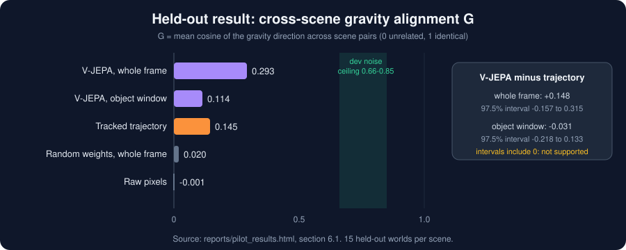

# Causal geometry of physical mechanisms in V-JEPA 2.1

**Does a frozen video model represent the *cause* of what it sees (gravity, bounce, friction), or only the trajectories those causes produce?**

This repository is a pre-registered pilot ("Protocol A") that tests this on the frozen V-JEPA 2.1 ViT-L 384 encoder, using simulated physics scenes where the true parameters are known and can be changed one at a time.

> **Status: pilot complete, main hypothesis not supported.** On held-out worlds, V-JEPA's gravity direction is more alike across scenes than for raw pixels or an untrained network, but it is **not distinguishable from a baseline that just tracks the object's trajectory**. Several planned analyses were not run (listed below).




## The idea in one minute

If the model's representation is organised by the physical cause, then changing gravity should move the representation in the same direction whether the object falls freely, bounces, or slides down a slope. If it only reflects what each motion looks like, the direction will differ from scene to scene.

The pilot makes that measurable:

1. Simulate three scenes (freefall, bounce, incline) in PyBullet. Each scene has 30 random worlds, split 15 development and 15 held-out before any analysis.
2. For each world, render a pair of clips that differ in exactly one parameter. For gravity the pair is g = 8.8 and g = 10.8 (base value 9.8, step 1.0). The base values of the other parameters are restitution e = 0.6 and friction mu = 0.25.
3. Feed both clips to frozen V-JEPA 2.1 and subtract the two representations: vector(g = 10.8) minus vector(g = 8.8). This difference is the **representation change** for gravity in that world. Average it over the 15 held-out worlds of the scene.
4. Compute **G**: the average cosine between the representation changes of the three scene pairs (freefall and bounce, freefall and incline, bounce and incline). G = 1 means the same direction in every scene; G = 0 means unrelated directions.
5. Compute G again for three baselines on the same worlds: raw pixels (16 frames downsampled to 16 x 16 RGB), V-JEPA with random weights, and the object's tracked trajectory. One further control compares gravity in one scene with a different parameter (restitution or friction) in the other scene; gravity-specific alignment should beat it.

## Terms used here

| Term | Meaning in this repo |
| --- | --- |
| Clip | One simulated video: 64 frames at 64 fps (1 second), 384 x 384 pixels |
| World | One random draw of a scene's nuisance settings (object size, colour, start height, horizontal start offset and speed, slope angle) |
| Scene | One of freefall (no floor; g only), bounce (floor; g and restitution e), incline (slope then flat run-out; g and friction mu) |
| Representation | The 1024-number vector from the final block of V-JEPA 2.1 ViT-L 384 for one clip. Whole-frame pooling averages all 18,432 token vectors; object-window pooling averages only the tokens near the moving object |
| Cosine | Similarity of two vectors by direction only, from -1 (opposite) through 0 (unrelated) to 1 (same direction) |
| Trajectory baseline | The same calculation on the simulator's tracked object positions (64 x 3 numbers per clip) instead of V-JEPA representations |

## Result



| Held-out test (H2) | Difference from trajectory baseline | 97.5% interval | Verdict |
| --- | --- | --- | --- |
| Whole-frame pooling | +0.148 | -0.157 to 0.315 | Not supported |
| Object-window pooling | -0.031 | -0.218 to 0.133 | Not supported |

| Hypothesis | Status |
| --- | --- |
| H1: changing a parameter gives a reliable change in the representation | Repeatability across worlds supported. Not shown to exceed render jitter (the change caused by a meaningless 5 mm camera shift). The original jitter test failed and its rule was replaced (amendment A4). |
| H2: gravity directions align across scenes more than baselines (primary, confirmatory) | **Not supported** |
| H3: physical vs. visual-nuisance subspaces separate | Not tested |
| H4: simultaneous changes add up in feature space | Not tested |

Full definitions, equations, conditions and the observed / unsupported / not-tested table are in [`reports/pilot_results.html`](reports/pilot_results.html).

## Things easy to miss

- The first Gate 1 test against the render-jitter floor **failed**; its pass rule was replaced after seeing the data (amendment A4). Both results stay recorded.
- The last layer does not localise objects, so object-window pooling there is not shown to isolate the object.
- Not done: nuisance separation (H3), composition (H4), effective rank / induced metric / principal angles on the final data, step-size (curvature) tests, optical-flow baseline, pendulum and collision scenes.

## Quick start

```bash
pytest tests                               # 149 tests, incl. golden-master comparisons
mypy                                       # strict typing of cg/ and the typed tests
ruff check                                 # lint (settings in pyproject.toml)
python3 scripts/ledger.py verify --files   # verify the hash-chained ledger
```

Feature extraction uses the official `facebookresearch/vjepa2` release and needs a GPU. Data and features live on a GPU volume, not in git; result files that matter are under `results/`.

## Repository map

| Path | What is in it |
| --- | --- |
| `cg/sim_pb.py` | PyBullet scenes (free fall, bounce, incline), deterministic headless render, token masks |
| `cg/features.py` | fp32 extraction from V-JEPA 2.1 ViT-L 384 (4 hierarchical taps; global and object-window pooling) |
| `cg/devstats.py`, `cg/primary.py` | Reliability, bootstrap, cross-scene alignment, the confirmatory endpoint |
| `cg/ledger.py` | The hash-chained ledger of every action and decision |
| `cg/geometry.py`, `cg/analysis.py`, `cg/simulate.py` | Early synthetic scaffold, kept for tests (smoke output is not a result) |
| `scripts/` | One script per gate or stage (`gate0.py` ... `stage7_cause_effect.py`, `heldout_primary.py`) |
| `configs/pilot.json` | Frozen decisions and amendments A1-A6 |
| `docs/01`-`docs/04` | The original pre-run design (protocol, theory, plans), kept unchanged on purpose |
| `reports/` | `pilot_results.html` (final report), `ledger_live.html` (browsable ledger) |
| `log/ledger.jsonl` | The ledger itself |
| `jobs/`, `scripts/pod_worker.py` | Git-based GPU pod job runner (see below) |

## Reading order

1. [`reports/pilot_results.html`](reports/pilot_results.html): the final report.
2. [`docs/01_VJEPA21_Pilot_Protocol.md`](docs/01_VJEPA21_Pilot_Protocol.md): the pre-registered design.
3. [`docs/02_Causal_Geometry_Theory.md`](docs/02_Causal_Geometry_Theory.md): the theory.
4. [`configs/pilot.json`](configs/pilot.json): frozen decisions and amendments.
5. [`reports/ledger_live.html`](reports/ledger_live.html): every action and decision.

## GPU pod worker (optional)

`scripts/pod_worker.py` runs inside the GPU pod: it `git pull`s, runs new `jobs/NNN_name.sh` scripts in order, and commits `results/jobs/<name>/` back. Heavy artifacts live on a persistent volume (`$CG_ROOT`). Kill switch: commit `jobs/STOP`.

Use a fine-grained GitHub token limited to this repository (Contents read/write); the worker keeps it out of git config, logs and job environments. Anyone with push access can run code on the pod.

```bash
cd /workspace/vjepa-causal-geometry/repo && git pull && python3 scripts/pod_worker.py
```

## License

No license file yet. Add one before reuse.
