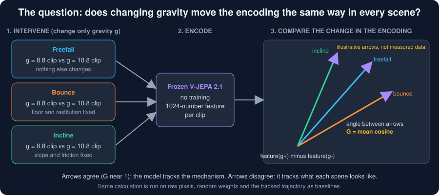

# Causal geometry of physical mechanisms in V-JEPA 2.1

**Does a frozen video model represent the *cause* of what it sees (gravity, bounce, friction), or only the trajectories those causes produce?**

This repository is a pre-registered pilot ("Protocol A") that tests this on the frozen V-JEPA 2.1 ViT-L 384 encoder, using simulated physics scenes where the true parameters are known and can be changed one at a time.

> **Status: pilot complete, main hypothesis not supported.** On held-out worlds, V-JEPA's gravity direction is more alike across scenes than for raw pixels or an untrained network, but it is **not distinguishable from a baseline that just tracks the object's trajectory**. Several planned analyses were not run (listed below).



## The idea in one minute

If a model understands that gravity is a *mechanism*, then changing gravity should move its internal features in a similar direction whether the object is falling freely, bouncing, or sliding down a slope. If it only encodes what the motion looks like, those directions will differ from scene to scene.

The pilot makes that measurable:

1. Simulate three scenes (freefall, bounce, incline) in PyBullet, 30 random worlds each, split 15 development / 15 held-out before any analysis.
2. For each world, render matched clips that differ in exactly one parameter (g, restitution e, or friction mu).
3. Take the difference in V-JEPA features between the plus and minus clip. That is the *direction of change* for that parameter.
4. Score how similar the gravity direction is across scenes (the alignment statistic **G**) and compare against four baselines run on the same worlds.

## Result


| Held-out test (H2) | Difference from trajectory baseline | 97.5% interval | Verdict |
| --- | --- | --- | --- |
| Whole-frame pooling | +0.148 | -0.157 to 0.315 | Not supported |
| Object-window pooling | -0.031 | -0.218 to 0.133 | Not supported |

| Hypothesis | Status |
| --- | --- |
| H1: parameter changes give a reliable change in features | Repeatability supported. Not shown to exceed render jitter. The original jitter test failed and its rule was replaced (amendment A4). |
| H2: gravity directions align across scenes more than baselines (primary, confirmatory) | **Not supported** |
| H3: physical vs. visual-nuisance subspaces separate | Not tested |
| H4: simultaneous changes add up in feature space | Not tested |

Full definitions, equations, conditions and the observed / unsupported / not-tested table are in [`reports/pilot_results.html`](reports/pilot_results.html).

## Things easy to miss

- The first Gate 1 test against the render-jitter floor **failed**; its pass rule was replaced after seeing the data (amendment A4). Both results stay recorded.
- The last layer does not localise objects, so object-window pooling there is not shown to isolate the object.
- Not done: nuisance separation (H3), composition (H4), effective rank / induced metric / principal angles on the final data, step-size (curvature) tests, optical-flow baseline, pendulum and collision scenes.

## Quick start

```bash
pytest tests                               # 40 tests
python3 scripts/ledger.py verify --files   # verify the hash-chained ledger
```

Feature extraction uses the official `facebookresearch/vjepa2` release and needs a GPU. Data and features live on a GPU volume, not in git; result files that matter are under `results/`.

## Repository map

| Path | What is in it |
| --- | --- |
| `cg/sim_pb.py` | PyBullet scenes (free fall, bounce, incline), deterministic headless render, token masks |
| `cg/features.py` | fp32 extraction from V-JEPA 2.1 ViT-L 384 (4 hierarchical taps; global and object-window pooling) |
| `cg/devstats.py`, `cg/primary.py` | Reliability, bootstrap, cross-scene alignment, the confirmatory endpoint |
| `cg/ledger.py` | The hash-chained ledger of every action and decision |
| `cg/geometry.py`, `cg/analysis.py`, `cg/simulate.py` | Early synthetic scaffold, kept for tests (smoke output is not a result) |
| `scripts/` | One script per gate or stage (`gate0.py` ... `stage7_cause_effect.py`, `heldout_primary.py`) |
| `configs/pilot.json` | Frozen decisions and amendments A1-A6 |
| `docs/01`-`docs/04` | The original pre-run design (protocol, theory, plans), kept unchanged on purpose |
| `reports/` | `pilot_results.html` (final report), `ledger_live.html` (browsable ledger) |
| `log/ledger.jsonl` | The ledger itself |
| `jobs/`, `scripts/pod_worker.py` | Git-based GPU pod job runner (see below) |

## Reading order

1. [`reports/pilot_results.html`](reports/pilot_results.html): the final report.
2. [`docs/01_VJEPA21_Pilot_Protocol.md`](docs/01_VJEPA21_Pilot_Protocol.md): the pre-registered design.
3. [`docs/02_Causal_Geometry_Theory.md`](docs/02_Causal_Geometry_Theory.md): the theory.
4. [`configs/pilot.json`](configs/pilot.json): frozen decisions and amendments.
5. [`reports/ledger_live.html`](reports/ledger_live.html): every action and decision.

## GPU pod worker (optional)

`scripts/pod_worker.py` runs inside the GPU pod: it `git pull`s, runs new `jobs/NNN_name.sh` scripts in order, and commits `results/jobs/<name>/` back. Heavy artifacts live on a persistent volume (`$CG_ROOT`). Kill switch: commit `jobs/STOP`.

Use a fine-grained GitHub token limited to this repository (Contents read/write); the worker keeps it out of git config, logs and job environments. Anyone with push access can run code on the pod.

```bash
cd /workspace/vjepa-causal-geometry/repo && git pull && python3 scripts/pod_worker.py
```

## License

No license file yet. Add one before reuse.
